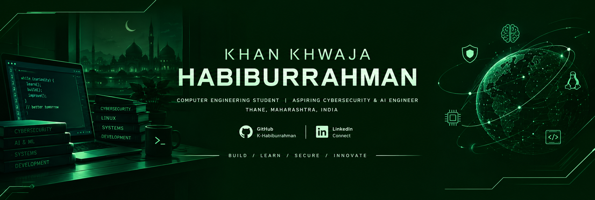

 

# HABIBURRAHMAN KHAN

**Computer Engineering Student | Aspiring Cybersecurity Engineer | AI Developer**

Interested in cybersecurity, artificial intelligence, Linux systems, and building practical technology.

[GitHub](https://github.com/K-Habiburrahman) · [LinkedIn](https://www.linkedin.com/in/khwaja-habiburrahman-khan-4b10aa355)

---

## About Me

I'm a third-year BE Computer Engineering student at AIKTC, exploring software development, cybersecurity, artificial intelligence, and connected systems.

- Exploring cybersecurity, ethical hacking, and endpoint security.
- Building AI-powered applications and RAG-based systems.
- Working with Linux, full-stack development, and IoT.
- Leading the Event Management Team at HackWithIndia × AIKTC.
- Exploring the scientific contributions of scholars of the Islamic Golden Age.

## Tech Stack

### Languages

  
  
  
  
  
  

### Tools & Technologies

  
  
  
  
  
  
  
  
  

## Featured Projects

<table>
<tr>
<td width="50%" valign="top">

### CyberMonitor

A Windows endpoint security-monitoring system that tracks running processes, network connections, open ports, system events, and security alerts through an interactive dashboard.

**Technologies:** Python, psutil, FastAPI, React, SQLite

[View repositories](https://github.com/K-Habiburrahman?tab=repositories)

</td>
<td width="50%" valign="top">

### Nyay Sahayak

An AI-powered multilingual legal assistant designed to make Indian law more accessible through conversational interaction, retrieval-augmented generation (RAG), and legal document references.

**Technologies:** React, Python, AI/ML, RAG

[View repository](https://github.com/K-Habiburrahman/Nyay_Sahayak)

</td>
</tr>
<tr>
<td width="50%" valign="top">

### ATMOS — Weather Core

An ESP8266-based IoT system that collects environmental data and displays weather and air-quality readings.

**Technologies:** ESP8266, Arduino, DHT11, MQ135

[View repositories](https://github.com/K-Habiburrahman?tab=repositories)

</td>
<td width="50%" valign="top">

### Bait Al-Hikmah Digital Exhibition

An educational exhibition documenting the scientific, mathematical, medical, and technological contributions of scholars of the Islamic Golden Age.

**Topics:** Astronomy, mathematics, medicine, engineering, and technology.

[Explore repositories](https://github.com/K-Habiburrahman?tab=repositories)

</td>
</tr>
<tr>
<td width="50%" valign="top">

### AI Resume Builder

An AI-assisted resume-building platform with professional resume creation and AI-powered mock interview preparation.

**Technologies:** React, Python, FastAPI, JavaScript, CSS

[View repositories](https://github.com/K-Habiburrahman?tab=repositories)

</td>
<td width="50%" valign="top">

### My ToolBox

An all-in-one web toolkit for QR generation, image conversion, PDF creation, audio utilities, developer tools, color utilities, and unit conversion.

**Technologies:** HTML, CSS, JavaScript, Web APIs

[Browse repositories](https://github.com/K-Habiburrahman?tab=repositories)

</td>
</tr>
</table>

## GitHub Analytics

 

## Current Focus

| Area | Focus |
|---|---|
| Cybersecurity | Endpoint monitoring, security fundamentals, incident response |
| AI & RAG | Practical AI applications and retrieval-based systems |
| Linux | System administration and security |
| Development | Full-stack applications and developer tools |
| IoT | Connected devices and environmental monitoring |

---

**Always learning. Always building. Always improving.**

[Connect on GitHub](https://github.com/K-Habiburrahman) · [Connect on LinkedIn](https://www.linkedin.com/in/khwaja-habiburrahman-khan-4b10aa355)

